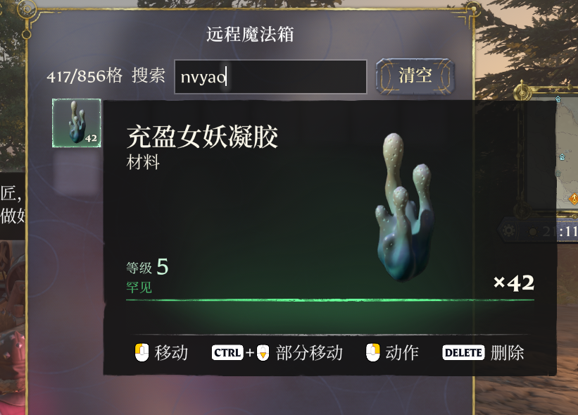
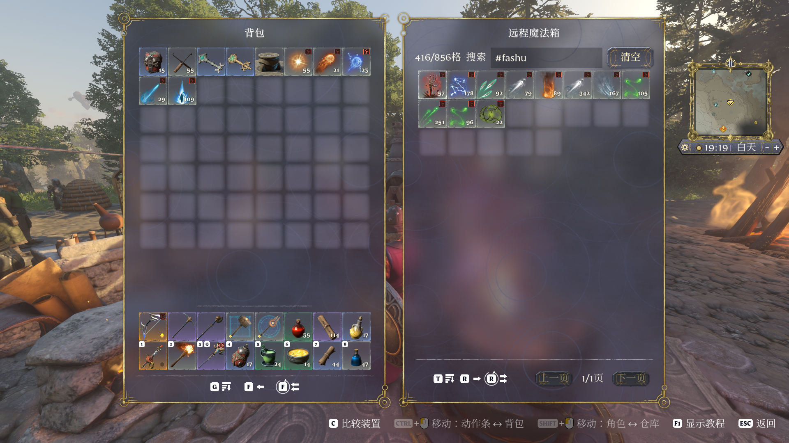

# XHL Remote Chest PinYin

远程魔法箱的拼音搜索。



## 用法

搜索框里输入：

```text
chongying    全拼，命中充盈女妖凝胶
nvyao        全拼，命中名称中段
ygh          首字母，命中远古核心
nuyao        ü 打 u 或 v 都行
```

`#` 开头按分类、类型、子类过滤：

```text
#fashu   #fs   #法术
#cailiao   #材料
```

分类过滤：



## 安装

把 `out/XHL-Remote-Chest-PinYin/` 整个目录复制到 XHL 加载器的Mod文件夹。

`native-plugin.ini` 控制加载器是否加载：

```ini
[Plugin]
Enabled=1
Dll=XHL-Remote-Chest-PinYin.dll
```

## 配置

`pin_yin.ini` 和 DLL 放在一起：

```ini
[Debug]
Hooks=1
IME=1
```

`Hooks=0` 关掉输入屏蔽，`IME=0` 关掉输入法接管。

## 日志

`XHL-Remote-Chest-PinYin.log`。看到 `signature mismatch` 或 `ui buffers unavailable` 说明游戏版本和插件对不上。

## 编译

需要 Windows x64、VS 2022 或更新版本、CMake 3.24+、Python 3（`pip install -r tools/requirements.txt`）。

```bat
cmake -S . -B build -A x64
cmake --build build --config Release
```

产物在 `out/XHL-Remote-Chest-PinYin/`。编译时会把 `data/` 里的 JSON 转成 `build/generated/` 下的 C 头文件，改完物品数据重新编译就行。

## 说明

特征码和 UI 偏移都是按 1.0.5 版本的 `XHL-Remote-Chest.dll` 适配。
